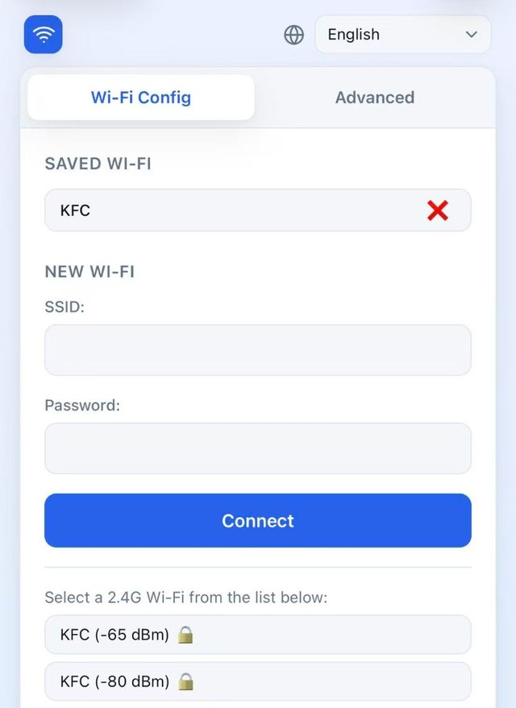

# ESP-WiFi-Connect

ESP-WiFi-Connect manages station connections and provides a web portal for
provisioning Wi-Fi credentials. This project uses a local copy of the component
with application-specific extensions; see the top-level README for how the
monitor enters provisioning mode.

[简体中文](README.zh_CN.md)

The component uses saved credentials when available. It can also start an
access point and web server at `http://192.168.4.1/` for provisioning.

## Configuration portal

The screenshot shows the v3.2 portal:



## Changelog

### v3.3.1

- Bound SSID/password copies into `wifi_config` so a full 32-byte SSID no longer overflows with `strcpy`.
- Config portal and SmartConfig now handle a maximum-length SSID without truncating or reading past the buffer.

### v3.3.0

- Persist each saved AP's channel in NVS as `channel`, `channel1`, ... `channel9` (same indexing as `password` / `passwordN`). 2.4 GHz (1-14) and 5 GHz (36-177) share one `uint8` key because the channel numbers do not overlap.
- The first station scan after start only visits those saved channels. If no matching AP is found, the next scan is a full-band scan.
- After a successful connection, the current channel is written back so later boots stay accurate if the AP moved.

### v3.2.0

- Station mode now connects to the strongest same-SSID AP. `StartConnect()` sets `WIFI_ALL_CHANNEL_SCAN` + `WIFI_CONNECT_AP_BY_SIGNAL` on the station config so the driver picks the AP with the best signal instead of the first match it finds (the previous default was `WIFI_FAST_SCAN`).
- Added `station_failure_retry_cnt` (default: 3) to `WifiManagerConfig`. The driver retries the strongest AP this many times before falling back to a weaker same-SSID AP, avoiding spurious fallback on a single transient auth failure.
- Added `show_ota_config` and `show_sleep_config` flags to `WifiManagerConfig`. Both default to `false`, hiding the corresponding fields in the config portal Advanced tab. Set them to `true` to make the fields visible.

### v3.1.0

- Event callback now includes an additional `data` parameter for extra information.
- Disconnected event now provides the disconnect reason code via the `data` parameter.
- This allows applications to handle different disconnect scenarios appropriately.

### v3.0.0

- Added WifiManager class for unified WiFi connection management.
- Improved DnsServer and WifiConfigurationAp classes for better resource handling.
- Updated HTML for configuration success message to use exit endpoint instead of reboot.
- Enhanced error handling and state management in WifiStation.
- Cleaned up unused code and improved thread safety across components.

### v2.6.0

- Add support for ESP32C5 5G mode.

### v2.4.0

- Add ja / zh-TW languages.
- Add advanced tab.
- Add "Connection: close" headers to save open sockets.

### v2.3.0

- Add support for language request.

### v2.2.0

- Add support for ESP32 SmartConfig(ESPTouch v2)

### v2.1.0

- Improve Wi-Fi connection logic.

### v2.0.0

- Add support for multiple Wi-Fi SSID management.
- Auto switch to the best Wi-Fi network.
- Captive portal for Wi-Fi configuration.
- Support for multiple languages (English, Chinese).

## Configuration

Wi-Fi credentials are stored in NVS under the `wifi` namespace.

The keys are `ssid` through `ssid9`, `password` through `password9`, and
`channel` through `channel9`. Channel is a `uint8`: `0` means unknown, `1–14`
means 2.4 GHz, and `36–177` means 5 GHz.

## Integration example

```cpp
#include <wifi_manager.h>
#include <ssid_manager.h>

// Initialize the default event loop
ESP_ERROR_CHECK(esp_event_loop_create_default());

// Initialize NVS flash for Wi-Fi configuration
esp_err_t ret = nvs_flash_init();
if (ret == ESP_ERR_NVS_NO_FREE_PAGES || ret == ESP_ERR_NVS_NEW_VERSION_FOUND) {
    ESP_ERROR_CHECK(nvs_flash_erase());
    ret = nvs_flash_init();
}
ESP_ERROR_CHECK(ret);

// Get the WifiManager singleton
auto& wifi_manager = WifiManager::GetInstance();

// Initialize with configuration
WifiManagerConfig config;
config.ssid_prefix = "ESP32";  // AP mode SSID prefix
config.language = "zh-CN";     // Web UI language

// Optional: tune connection-to-strongest-AP behavior
// config.station_failure_retry_cnt = 3;  // retries before falling back to weaker AP

// Optional: show advanced fields in the config portal
// config.show_ota_config = true;    // show Custom OTA URL input
// config.show_sleep_config = true;  // show Sleep Mode toggle

wifi_manager.Initialize(config);

// Set event callback to handle WiFi events
// The callback receives the event type and optional data (e.g., disconnect reason)
wifi_manager.SetEventCallback([](WifiEvent event, const std::string& data) {
    switch (event) {
        case WifiEvent::Scanning:
            ESP_LOGI("WiFi", "Scanning for networks...");
            break;
        case WifiEvent::Connecting:
            ESP_LOGI("WiFi", "Connecting to network...");
            break;
        case WifiEvent::Connected:
            ESP_LOGI("WiFi", "Connected successfully!");
            break;
        case WifiEvent::Disconnected:
            // data contains the disconnect reason code
            ESP_LOGW("WiFi", "Disconnected from network, reason: %s", data.c_str());
            break;
        case WifiEvent::ConfigModeEnter:
            ESP_LOGI("WiFi", "Entered config mode");
            break;
        case WifiEvent::ConfigModeExit:
            ESP_LOGI("WiFi", "Exited config mode");
            break;
    }
});

// Check if there are saved Wi-Fi credentials
auto& ssid_list = SsidManager::GetInstance().GetSsidList();
if (ssid_list.empty()) {
    // No credentials saved, start config AP mode
    wifi_manager.StartConfigAp();
} else {
    // Try to connect to the saved Wi-Fi network
    wifi_manager.StartStation();
}
```

Please check https://github.com/78/xiaozhi-esp32 for more usage.
